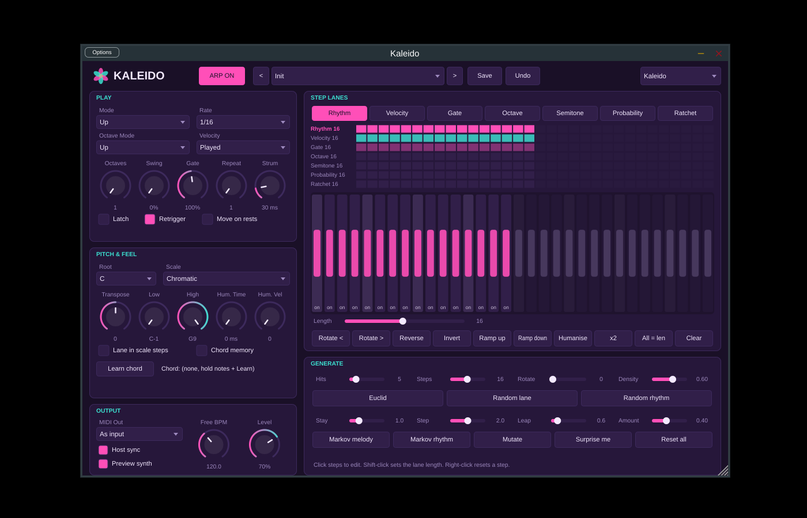

# Kaleido (working name)

A versatile MIDI arpeggiator and step-pattern generator (VST3, AU, AU MIDI FX and standalone).
18 modes, seven step lanes with independent lengths, probability, ratchets, scales, chord memory,
Euclidean, random and Markov generators, 86 factory presets and 7 themes.
See `docs/DESIGN.md` for the plan and feature list.



## Build

```
cmake -B build -DCMAKE_BUILD_TYPE=Release            # fetches JUCE 8.0.4
# or: cmake -B build -DJUCE_DIR=/path/to/JUCE
cmake --build build --config Release
ctest --test-dir build                                # engine tests
```

macOS builds target macOS 11+ universal (Intel + Apple Silicon). Windows builds use the static runtime.
Linux needs the usual JUCE packages (ALSA, X11, Xrandr, Xinerama, Xcursor, freetype, fontconfig).

## Using it in a DAW

VST3 has no proper "MIDI effect" type, so the VST3 loads as an instrument that outputs MIDI:

- **Ableton Live**: put Kaleido on a MIDI track, then on your synth's track set *MIDI From* to that
  track and choose *Kaleido* in the second menu.
- **Bitwig, Reaper, FL Studio, Cubase, Studio One**: route the plugin's MIDI output to the
  instrument (in Reaper, put Kaleido before the synth on the same track).
- **Logic Pro**: use **Kaleido MIDI FX** in the MIDI FX slot (AU MIDI-processor build, macOS only).
- **Standalone**: choose MIDI input and output ports under *Options > Audio/MIDI Settings*. The
  built-in preview synth is on by default so you hear something straight away.

## Layout

`Source/engine` is plain C++ (arp engine, generators, presets, preset text format) with tests in
`tests/`. `Source/plugin` is the JUCE wrapper, preview synth, themes and UI.
User presets are saved as `.kalp` text files in the user application-data folder under
`Kaleido Audio/Kaleido/Presets`.
